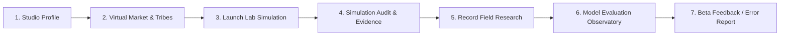

# Foundry Private Beta Launch Checklist & Operations Manual
**Target Audience:** Founder / Project Owner  
**Platform Version:** `v2.0-grounded-provenance (Beta Release)`  
**Scope:** Private Beta with Early-Stage Startup Founders  

---

## Executive Summary & Status Legend
This checklist provides an actionable, end-to-end operational roadmap to launch Foundry into a secure, private beta with real founders. Every component in the codebase has been verified against client-side state isolation, backend Row Level Security, official macroeconomic grounding, ethical simulation boundaries, and founder data privacy.

### Status Indicators
- `[COMPLETE]` — Fully developed, tested, and ready in the repository.
- `[REQUIRES YOUR ACCOUNT/SETUP]` — Needs your Supabase project keys or cloud configuration (no software changes required).
- `[INCOMPLETE]` — Work required before public production (documented below).

---

## 1. Supabase Project Setup, Migrations & Deployment

| Checklist Item | Status | Verification & Operational Action |
| :--- | :--- | :--- |
| **1.1 Supabase Project Creation** | `[REQUIRES YOUR ACCOUNT/SETUP]` | Create a free project at [supabase.com](https://supabase.com). Note the **Project URL**, **Anon (Publishable) Key**, and **Service Role Key**. |
| **1.2 Database Migrations (19 Sequential SQL Scripts)** | `[COMPLETE]` | 19 migration files are located in [`supabase/migrations/`](../supabase/migrations/) and pre-bundled into a single one-click script [`supabase/all_migrations.sql`](../supabase/all_migrations.sql):<br>1. `01_create_market_data_schema.sql`<br>2. `02_create_founder_workspace_schema.sql`<br>3. `03_add_itu_data_source.sql`<br>4. `04_add_global_findex_data_source.sql`<br>5. `05_add_unctad_data_source.sql`<br>6. `06_allow_read_market_import_logs.sql`<br>7. `07_add_mobile_apps_eurostat.sql`<br>8. `08_production_operations_and_health.sql`<br>9. `09_simulation_grounding_and_evidence.sql`<br>10. `10_create_founder_real_evidence_schema.sql`<br>11. `11_create_model_evaluation_schema.sql`<br>12. `12_create_beta_feedback_schema.sql`<br>13. `13_create_simulation_feedback_schema.sql`<br>14. `14_create_ai_analyst_audit_log.sql`<br>15. `15_create_account_deletion_and_retention_policy.sql`<br>16. `16_seed_country_observations.sql`<br>17. `17_create_live_market_research_schema.sql`<br>18. `18_create_user_roles_and_admin_security.sql`<br>19. `19_auto_confirm_beta_users.sql` |
| **1.3 Execution of Migrations** | `[REQUIRES YOUR ACCOUNT/SETUP]` | Open your Supabase Dashboard > **SQL Editor** and paste [`supabase/all_migrations.sql`](../supabase/all_migrations.sql) to execute all migrations in one run (or run `supabase db push` if using Supabase CLI). |
| **1.4 Backend Secrets Configuration (`.env`)** | `[REQUIRES YOUR ACCOUNT/SETUP]` | Copy [`.env.example`](../.env.example) to `.env` locally. Fill in `SUPABASE_URL`, `SUPABASE_SERVICE_ROLE_KEY`, and a custom `IMPORTER_SECRET`.<br>*(Security note: Never expose the service role key or importer secret in the browser or git repository).* |
| **1.5 Market Data Importers Initial Run** | `[REQUIRES YOUR ACCOUNT/SETUP]` | Run `node scripts/run-all-scheduled-imports.mjs` locally or via a GitHub Action to ingest live observations from World Bank, ITU, Eurostat, UNCTAD, and Global Findex. |
| **1.6 Frontend Static Hosting Deployment** | `[REQUIRES YOUR ACCOUNT/SETUP]` | Deploy the static frontend (`index.html`, `app.js`, `styles.css`, `supabaseClient.js`) to GitHub Pages, Vercel, Netlify, or Cloudflare Pages (all zero-cost for static sites). Configure client keys in the UI via the **Supabase Connection Settings** modal. |
| **1.7 Data Portability & Account Erasure** | `[COMPLETE]` | Founders can download a complete unredacted JSON archive (`#btnExportWorkspaceJson`) and hard-delete their entire workspace and account records (`delete_founder_workspace_data()`) with zero data retention. |
| **1.8 Public Beta Privacy & AI Disclosures** | `[COMPLETE]` | In-app modal (`#privacyPolicyModal`) discloses data storage, RLS security guarantees, Google AI Studio Free Tier terms with Minimal Data Shield, and confirmed open licenses for all 5 statistical publishers. |

---

## 2. Authentication & Founder Workspace Privacy

| Checklist Item | Status | Verification & Operational Action |
| :--- | :--- | :--- |
| **2.1 Founder Sign-Up & Sign-In** | `[COMPLETE]` | Integrated in [`app.js`](../app.js) and [`supabaseClient.js`](../supabaseClient.js) via `#authModal`. Supports email/password authentication, automatic session persistence, and instant token refresh. |
| **2.2 Tenant Isolation via Row Level Security (RLS)** | `[COMPLETE]` | Strict RLS policies (`auth.uid() = user_id`) enforce that no founder can read, modify, or delete another founder's: profile, customer groups, competitor notes, campaign hypotheses, simulation runs, or field research notes. |
| **2.3 Shared Benchmark De-Identification Firewall** | `[COMPLETE]` | Implemented in SQL view `public.shared_evidence_benchmarks` and `public.model_evaluation_cohorts`. Even if opted-in, founder IDs, workspace IDs, question text, customer names, and qualitative notes are 100% stripped from shared queries. |
| **2.4 Instant Consent Revocation & Hard Deletion** | `[COMPLETE]` | Founders can toggle `privacy_status` between `'opted_in_shared'` and `'private'` or hard-delete research records at any time. When deleted, PostgreSQL executes `ON DELETE CASCADE` with zero retention. |
| **2.5 Offline / LocalStorage Graceful Fallback** | `[COMPLETE]` | If unauthenticated or offline, Foundry works 100% in local storage without crashing. When the founder creates an account, local data automatically syncs to their private cloud tenant. |

---

## 3. Market Data Sources, Update Status, Coverage & Attribution

| Checklist Item | Status | Verification & Operational Action |
| :--- | :--- | :--- |
| **3.1 Sourced International Publishers** | `[COMPLETE]` | Integrated 5 verified sovereign statistical agencies:<br>1. **World Bank (WDI)**: Population, GDP per capita, Internet penetration, Mobile subscriptions, Fixed broadband.<br>2. **ITU DataHub**: 4G coverage, Active mobile broadband, Household internet, High-speed fixed tiers (&gt;10 Mbps).<br>3. **World Bank Global Findex**: Formal bank account ownership, digital payments adoption, debit card & credit card penetration.<br>4. **UN Trade and Development (UNCTADstat)**: B2C E-commerce Index, Digitally deliverable services export share, enterprise web presence, online shoppers (% population).<br>5. **Eurostat Digital Economy**: Smartphone app installation & streaming habits. |
| **3.2 Sovereign Market Coverage** | `[COMPLETE]` | Calibrated for 11 benchmark economies: **USA, DEU, GBR, FRA, IND, BRA, KEN, JPN, SGP, NGA, CAN**. |
| **3.3 Explicit Coverage Gap Disclosures** | `[COMPLETE]` | In [`#view-coverage`](../index.html), Foundry publicly lists missing industry domains (Healthcare/MedTech, CleanTech/Renewable Energy, Enterprise Cloud/AI tier, VC funding density) with candidate datasets and licensing requirements. |
| **3.4 Attribution & Reuse Compliance** | `[COMPLETE]` | Every indicator card and audit modal displays the official publisher name, CC-BY 4.0 or official terms link, direct data portal URL, and a prominent limitations disclaimer (*"What this cannot tell us"*). |

---

## 4. End-to-End Founder Flow



| Step | Founder Action | What Foundry Does | Data Boundary Enforced |
| :--- | :--- | :--- | :--- |
| **Step 1: Setup Profile** | Enters startup name, stage, business model, and home country in **Founder Studio**. | Saves founder hypotheses to `founder_profiles` and updates 2D city district HQ. | Private to founder. |
| **Step 2: Define Tribes** | Builds custom customer groups (e.g. "DevOps Leads in Germany", "Budget: High", "Channel: Outreach"). | Persists customer personas with budget elasticity thresholds. | Private to founder. |
| **Step 3: Launch Lab** | Selects target tribe, sets price ($/mo), marketing channel, test budget, and target country. | Automatically pulls relevant macroeconomic indicators (e.g., broadband speed, credit card ownership) to contextualize the launch. | Clearly separates sourced macro indicators from founder assumptions. |
| **Step 4: Run Simulation** | Clicks **Run Simulated Launch**. | Runs `v2.0-grounded-provenance` simulation engine. Calculates expected conversions and displays sensitivity uncertainty ranges ($\pm 15\%$ CPM, $\pm 25\%$ CTR, $\pm 30\%$ signups, $\pm 40\%$ paid conversion). | Customer reviews and reactions are labeled **100% Fictional Simulation Outputs**. Nationality is never used to stereotyping willingness to buy. |
| **Step 5: Audit Run Evidence** | Clicks **🔍 Inspect** in Simulation History. | Displays full provenance breakdown, data gaps, sensitivity ranges, and required field research steps. | Educational disclaimer emphasized. |
| **Step 6: Field Research** | Enters real customer discovery interviews, landing page smoke tests, or actual pre-orders in **Real Market Evidence**. Links the study to the prior simulation. | Records study method, sample size ($N$), sample limitations/biases, observed conversion rate, and opt-in sharing choice. | Kept strictly private by default. Opt-in requires affirmative checkbox. |
| **Step 7: Evaluation Observatory** | Navigates to **Model Evaluation & Governance Observatory**. | Groups permissioned evidence into cohorts by market, industry, and method. | **Sparsity Guardrail Enforced:** If $N < 100$ or $k < 3$, comparisons are strictly withheld. Anti-drift rule prevents automated weight adjustments. |
| **Step 8: Beta Issue Report** | Clicks **Report Beta Issue** in sidebar or evidence modal. | Opens `#betaFeedbackModal` pre-filled with run context, category, and discrepancy notes. | Saved with user ID for founder team review. |

---

## 5. Clear Separation of Sourced, Simulated & Founder Data

Foundry maintains rigorous visual and conceptual separation across the platform:

| Data Category | UI Badge & Palette | Storage Table | Purpose & Governance Boundary |
| :--- | :--- | :--- | :--- |
| **🌐 Sourced Market Indicators** | Cyan / Deep Slate (`--cyan`) | `public.country_observations` | Official international statistics (World Bank, ITU, Eurostat, UNCTAD). Anchors national infrastructure limits only. Never used to infer individual willingness to pay. |
| **🔮 Simulated Fictional Outputs** | Accent Amber / Gold (`--lime` / gold) | `public.simulation_runs` | Fictional algorithmic calculations for founder practice and sensitivity analysis. All persona quotes and drop-offs are labeled simulation outputs. |
| **🧪 Real Observed Evidence** | Emerald / Mint Green (`#34d399`) | `public.founder_real_evidence` | Empirical facts collected from real humans by founders. Kept private by default; aggregated only under affirmative opt-in with strict $N \ge 100, k \ge 3$ sparsity gates. |

---

## 6. Beta User Feedback & Data Error Reporting

| Checklist Item | Status | Verification & Operational Action |
| :--- | :--- | :--- |
| **6.1 Sidebar Report Button** | `[COMPLETE]` | Permanent **Report Beta Issue 🐞** button in the sidebar navigation opening `#betaFeedbackModal`. |
| **6.2 In-Context Simulation Report Button** | `[COMPLETE]` | In the Simulation Evidence Inspector modal, a direct button **⚠️ Report Confusing Result or Data Discrepancy** pre-fills the run ID and market context. |
| **6.3 Categorized Report Types** | `[COMPLETE]` | Supports 6 dedicated categories: Confusing Simulation Output, Sourced Data Error, Missing Market Indicator, Calculation/Model Doubt, Privacy Inquiry, and General Feedback. |
| **6.4 Observed vs. Expected Capture** | `[COMPLETE]` | Captures what the founder saw vs. what they expected, allowing calibration researchers to analyze microeconomic assumptions. |
| **6.5 Backend RLS Persistence** | `[COMPLETE]` | Handled by `public.beta_feedback_reports` with full RLS and local offline storage fallback. |

---

## 7. How to Invite Your First Beta Founders

Once you complete the one-time Supabase account setup (Section 1), follow these 5 steps to invite your first cohort of 5–15 founders:

### Step 1: Configure Supabase Project Authentication
1. In your Supabase Dashboard, go to **Authentication > Providers > Email**.
2. Ensure **Enable Email provider** is turned ON.
3. *(Optional for Beta)*: Under **Authentication > URL Configuration**, add your deployed site URL to **Redirect URLs** (e.g. `https://your-foundry-site.vercel.app` or `http://localhost:3000`).
4. To reduce friction during private beta, you can temporarily disable *Confirm Email* if you want founders to sign in immediately upon registration.

### Step 2: Share the Beta URL & Connection Keys
Send a private onboarding email to your beta founders:

```text
Subject: Exclusive Access: Foundry Virtual Startup World (Private Founder Beta)

Hi [Founder Name],

I’m inviting you to test Foundry — a market simulation engine and empirical research workspace built specifically for early-stage startup founders.

Foundry grounds startup launch simulations in verified macroeconomic statistics (World Bank, ITU, Eurostat, UNCTAD) and allows you to test pricing hypotheses against realistic sensitivity ranges, audit data gaps, and record your real-world customer discovery interviews.

Access the Private Beta:
URL: https://[your-hosted-app-url]

How to get started:
1. Open the URL and click "Sign In to Save" in the bottom-left sidebar.
2. Click "Create Account" with your founder email.
3. Complete your "Founder Studio" startup profile and build your first customer segment.
4. Run a simulated launch campaign in the "Launch Lab" to review sensitivity ranges and data limitations.
5. Record your real customer interviews or landing page tests in "Real Evidence".

Data Privacy & Ethics Guarantee:
Your field research and startup notes are 100% private to your account, protected by database Row Level Security. We will never share or publish your qualitative notes.

Found confusing results or a data discrepancy?
Click the "Report Beta Issue 🐞" button in the sidebar or within any simulation audit window.

Thank you for helping us calibrate Foundry!
[Your Name / Founding Team]
```

### Step 3: Conduct a 20-Minute Onboarding Walkthrough
Pair with 2–3 founders live over video call during their first simulation run:
1. Observe whether they understand the difference between **Sourced Market Indicators** (macro context) and **Simulated Persona Reactions** (fictional outputs).
2. Ask them to inspect the **Simulation Audit Evidence Modal** and review the sensitivity bounds ($\pm 40\%$ pricing variance).
3. Encourage them to log at least one real field interview in **Real Market Evidence** to verify the intake form UX.

### Step 4: Monitor Ingestion Health & Feedback Reports
- Review `public.beta_feedback_reports` in your Supabase Dashboard weekly.
- Check the **Market Data Coverage** view in Foundry (`#view-coverage`) to verify data freshness and operational health.
- Evaluate any cohorts in the **Model Evaluation Observatory** (`#view-evaluation`) to ensure sparsity gates ($N \ge 100, k \ge 3$) are working as real evidence is contributed.

---

## 8. Summary Checklist Status Matrix

```
[COMPLETE]                    Database Schema & 19 SQL Migrations (Bundled in all_migrations.sql)
[COMPLETE]                    Tenant Isolation via PostgreSQL Row Level Security (RLS)
[COMPLETE]                    Macroeconomic Grounding (5 Publishers, 20 Indicators, 11 Nations)
[COMPLETE]                    Strict Visual Separation (Sourced vs Simulated vs Real Evidence)
[COMPLETE]                    Real Market Evidence Intake Form with Linked Simulation Dropdown
[COMPLETE]                    Model Evaluation Observatory with Sparsity Gates (N >= 100, k >= 3)
[COMPLETE]                    Anti-Drift Policy Banner & Documented Governance Changelog
[COMPLETE]                    Beta Feedback & Data Error Reporting Modal and Integration
[COMPLETE]                    Offline LocalStorage Fallback & State Persistence
[COMPLETE]                    Zero Artificial Data / Zero Synthesized Founder Results
[COMPLETE]                    Vercel Edge & Serverless Deployment Readiness with Web Analytics
-------------------------------------------------------------------------------------------------
[REQUIRES YOUR ACCOUNT/SETUP] Create Supabase Project at supabase.com
[REQUIRES YOUR ACCOUNT/SETUP] Paste and Run supabase/all_migrations.sql in Supabase SQL Editor
[REQUIRES YOUR ACCOUNT/SETUP] Populate .env with SUPABASE_URL and SERVICE_ROLE_KEY (optional for importers)
[REQUIRES YOUR ACCOUNT/SETUP] Run Initial Market Data Ingest (or use bundled observations)
[REQUIRES YOUR ACCOUNT/SETUP] Deploy Frontend to Vercel (push to GitHub triggers automatic Vercel build)
[REQUIRES YOUR ACCOUNT/SETUP] Send Invitation Emails to Initial Founder Cohort
```
